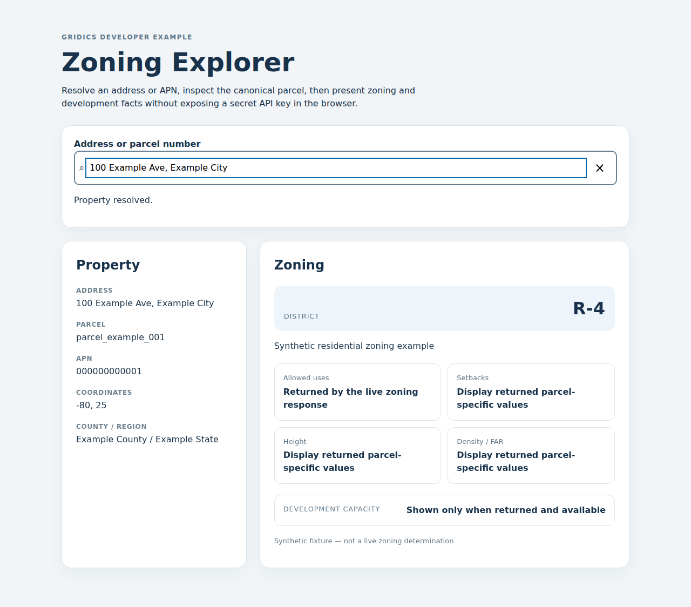

# React Zoning Explorer

This is the flagship visual cookbook example: address/APN resolution on the left, parcel-specific zoning and development facts on the right.

## Run immediately with synthetic data

Use Node.js 22.12+ or 24. From the repository root:

~~~bash
cd examples/react-zoning-explorer
npm ci
npm run dev
~~~

Fixture mode is the default. It makes no live zoning request and uses the same synthetic Location Search behavior as the other browser example.

The address/APN field is interactive autocomplete: it suggests candidates and retrieves the selected one with the same search session. For a one-off server resolution without a picker, use [Location Search forward](../../recipes/18-location-search/) instead. The zoning panel is fixture-backed until your own server adapter is connected and verified against your entitled data.

## Try the example

1. Open the local URL printed by Vite.
2. Enter `100 Example` in **Address or parcel number** and choose the suggested property.
3. Inspect the resolved parcel and the synthetic **R-4** zoning panel. Use the clear button to start another search.

This screenshot shows the default synthetic fixture. It demonstrates the interface;
it is not a zoning determination, live API response, or proof of coverage for an address.
The example does not require an account or API key in fixture mode.

## Live architecture

Browser Location Search may use a scoped publishable **gpk_...** token when your Developer Portal account supports it. Secret **gk_...** keys must never enter Vite environment variables or browser JavaScript.

For live zoning, set **VITE_ZONING_PROXY_URL** to your own server-side endpoint. That endpoint should hold the Gridics secret, resolve/validate the canonical parcel supplied by your application, call the public zoning API, and return only the fields your UI needs.

The server-side building blocks are [recipe 03](../../recipes/03-property-lookup/), [recipe 04](../../recipes/04-zoning-query/), and [recipe 17](../../recipes/17-appraiser-zoning-lookup/).

## Why the example is split this way

A polished browser experience should not require exposing a privileged API key. The UI demonstrates composition and capability-aware rendering while the cookbook's seven server languages demonstrate authenticated API calls.

Never convert missing zoning or development fields into zero, false, or a legal conclusion.

## Changing or clearing a selection

Only the current property selection can update its zoning panel. Changing or
clearing a selection cancels the pending browser request and discards late
results or errors, including from custom adapters that cannot cancel their
underlying work. Cancellation does not reverse work already completed by your
server. Clearing also resets the loading state; unmounting stops the pending
browser request.
